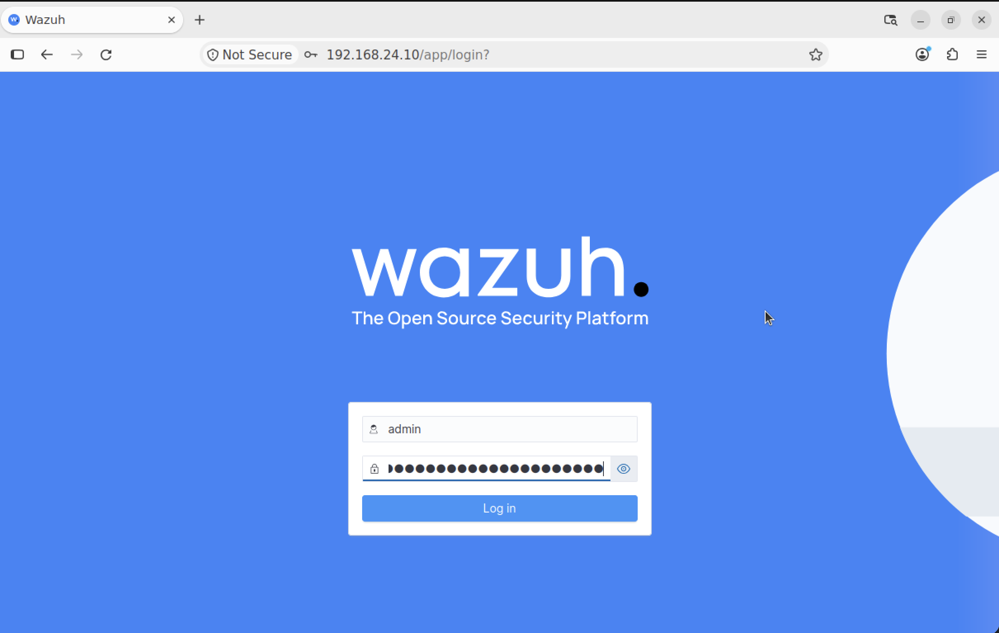
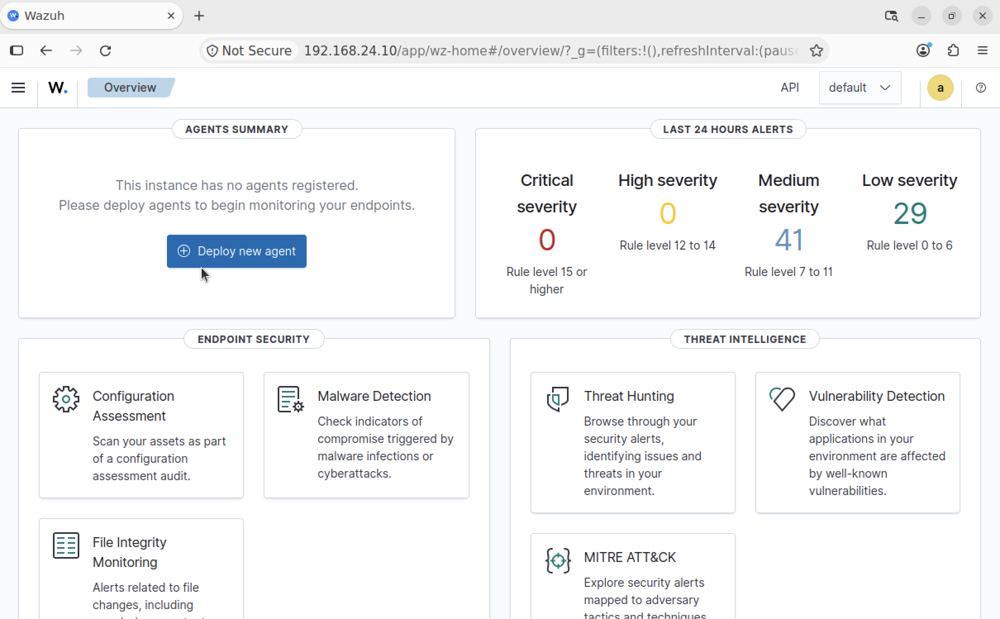
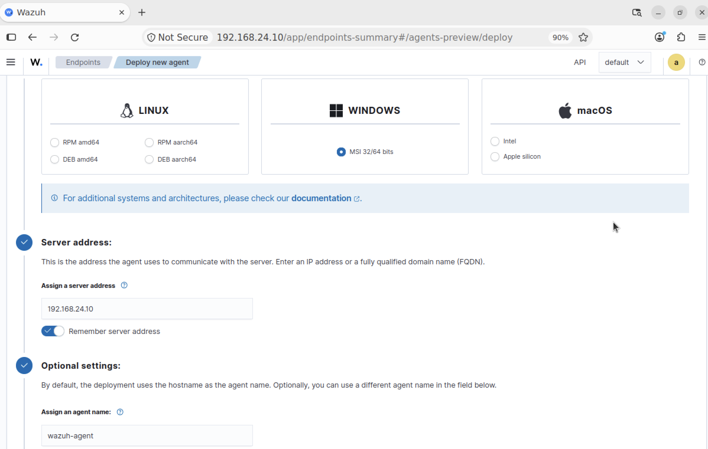
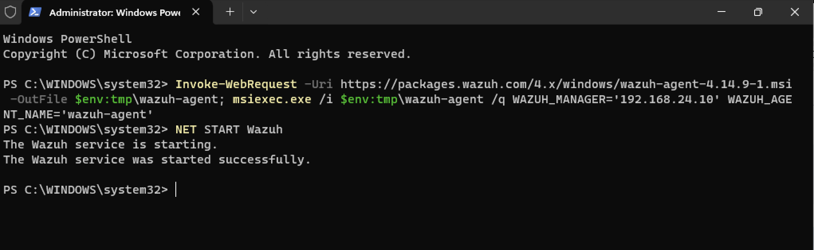
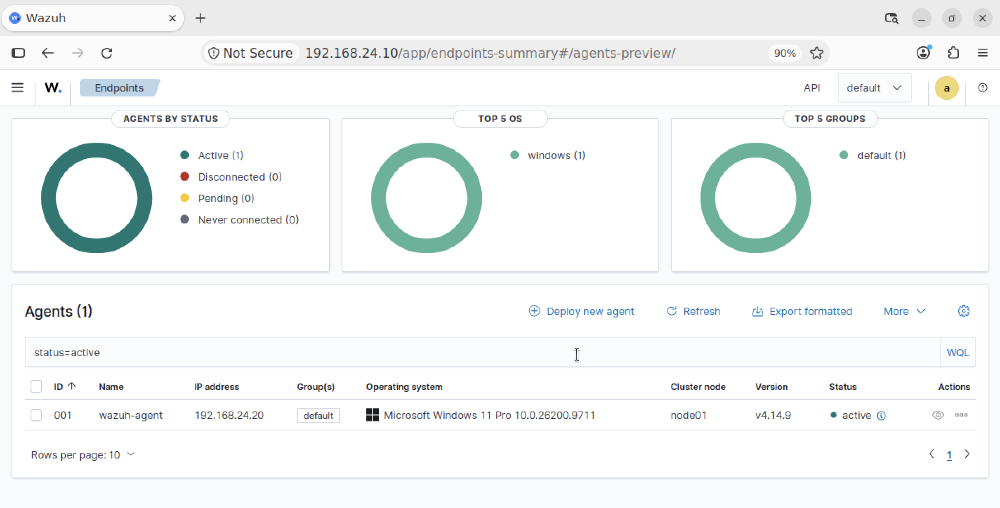

# SIEM Detection Lab

## Project Overview

This lab demonstrates centralized security log collection, analysis, and threat detection using Wazuh within an isolated virtual network environment designed to simulate a small-scale Security Operations Center (SOC). It illustrates how security events are collected from endpoints, analyzed by the SIEM, and investigated to identify potentially suspicious activity.


## Table of Contents

- [Lab Environment](#lab-environment)
- [Lab Diagram](#lab-diagram)
- [Wazuh Manager Installation](#wazuh-manager-installation)
- [Wazuh Agent Installation](#wazuh-agent-installation)
- [Sysmon Installation (Optional)](#sysmon-installation)
- [Detection Testing](#detection-testing)

---

## Lab Environment

| Component | Role
|------|---------|
| UTM | Virtualization Platform |
| Ubuntu Server 26.04 | Wazuh Manager |
| Windows 11 | Wazuh Agent |
| Kali Linux | Attacker Machine |
| Wazuh | SIEM Platform |

### VM Configuration

Each virtual machine was configured according to its role within the lab.

| Virtual Machine | Memory | Processors | Storage | Network Mode |
|---------|---------|---------|---------|---------|
| Ubuntu Server 26.04 | 8 GB | 2 | 60 GiB | Shared Network & Host Only |
| Windows 11 | 4 GB | 2 | 64 GiB | Shared Network & Host Only |
| Kali Linux | 4 GB | 2 | 40 GiB | Host Only |

Ubuntu Server and Windows 11 were configured with Shared Network (NAT) and Host Only adapters to provide internet access while maintaining an isolated network for communication between the virtual machines. Kali Linux was set up to use the Host Only network for controlled testing against the other machines.

---

## Lab Diagram

Ubuntu Server (192.168.24.10)
Windows 11 (192.168.24.20)
Kali Linux (192.168.24.30)
Picture of lab architecture

---

## Wazuh Manager Installation
**Note:** Upon installing Ubuntu Server 26.04, the default interface was command-line based. Although not a requirement, the following commands were executed to install a graphical desktop environment and update the system packages:

```
sudo apt update && sudo apt upgrade -y
sudo apt install ubuntu-desktop -y
sudo reboot
```

After installing the Ubuntu desktop environment, the Wazuh Manager, Dashboard, and Indexer were installed using the Wazuh installation script downloaded with `curl`.

```
curl -sO https://packages.wazuh.com/4.14/wazuh-install.sh
sudo bash ./wazuh-install.sh -a
```

Upon successful installation, the Wazuh installation script provided the credentials required to access the Wazuh Dashboard. The Dashboard was accessed by entering the server's IP address into the web browser and providing the username and password.

```
https://192.168.24.10
```



---

## Wazuh Agent Installation

After accessing the Wazuh Dashboard, **Deploy new agent** was selected to configure the Windows 11 agent with the following settings:
- **Operating system:** `Windows`
- **Server address:** `192.168.24.10`
- **Agent name:** `wazuh-agent`




Following the configuration, the Wazuh Dashboard generated an installation command for the agent. The command was copied and executed in Windows PowerShell on the Windows 11 virtual machine to install the Wazuh agent.

```
Invoke-WebRequest -Uri https://packages.wazuh.com/4.x/windows/wazuh-agent-4.14.9-1.msi -OutFile $env:tmp\wazuh-agent; msiexec.exe /i $env:tmp\wazuh-agent /q WAZUH_MANAGER='192.168.24.10' WAZUH_AGENT_NAME='wazuh-agent' 
```

After installing the Wazuh agent, the service was started using the following command in **Windows PowerShell**. The agent's status was then verified in the Wazuh Dashboard.

```
NET START Wazuh
```




---

## Sysmon Installation (Optional)

As an optional enhancement, **Sysmon (System Monitor)** was installed on the Windows 11 endpoint to capture additional system activity and enhance security monitoring.

For detailed installation and configuration instructions, see
[Sysmon Installation and Configuration](docs/sysmon-installation.md).

---

## Detection Testing

The lab was tested by simulating security-related activities on the Windows 11 endpoint and verifying whether the resulting events were collected and analyzed by Wazuh. The following scenarios were selected to evaluate the SIEM's event monitoring and threat detection capabilities.


| Test Scenario | Objective
|------|---------|
| User Account Creation | Verify monitoring of newly created Windows user accounts. |
| Failed Login Attempts | Identify unsuccessful authentication attempts. |
| File Integrity Monitoring | Detect changes to monitored files and directories. |
| Suspicious PowerShell Execution | Identify potentially suspicious command execution on the Windows endpoint. |
| Network Reconnaissance | Investigate network scanning activity originating from the Kali Linux VM. |
| SSH Brute Force | Detect repeated unsuccessful SSH authentication attempts against a Linux host. |

For detailed testing procedures, configuration, screenshots, and results, see [Detection Testing](docs/detection-testing.md).


ADD lines to separate