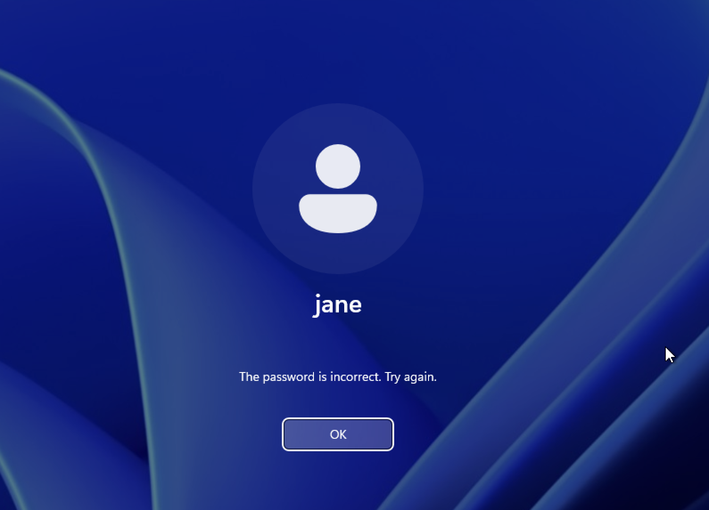
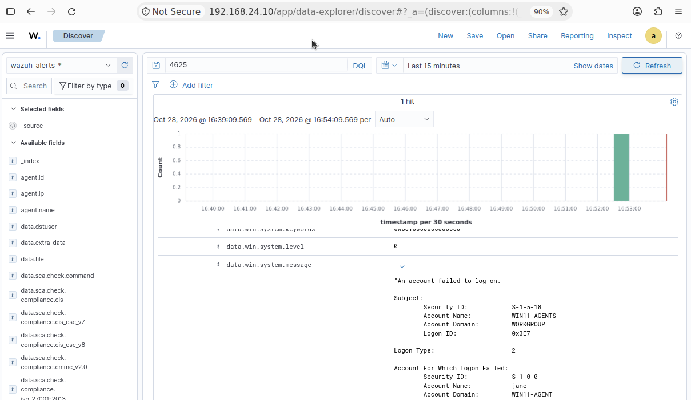
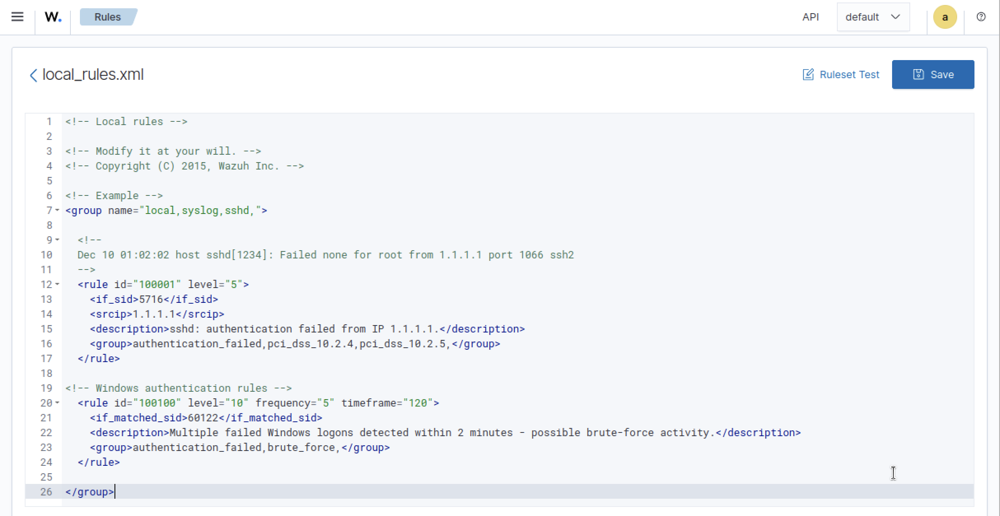
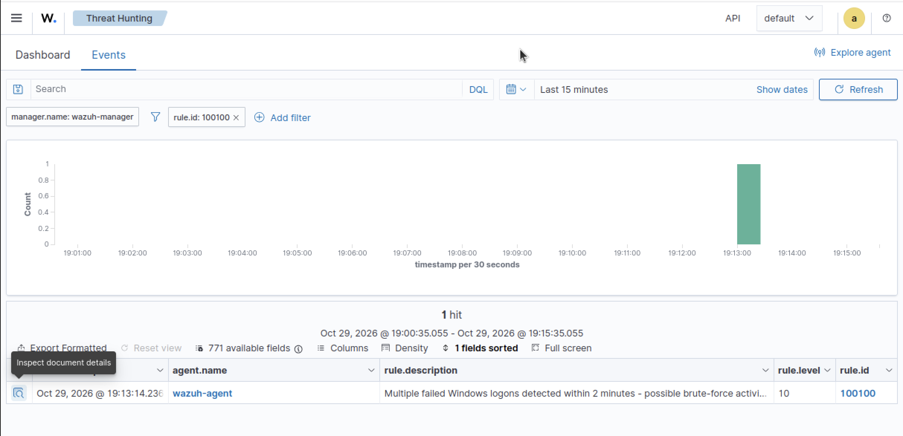

# Failed Logins

## Objective

To verify that unsuccessful Windows authentication attempts are recorded by Wazuh and determine whether repeated failed login attempts trigger a custom detection rule.

## Test Procedure

### Single Login Attempt (Baseline)

Using the previously created local Windows user account, a single unsuccessful login attempt was performed to establish a baseline for generating an alert.




### Multiple Failed Logins

#### Custom Rule Configuration

A custom rule was configured on the Wazuh Dashboard to detect repeated unsuccessful Windows logon attempts within a specified time window. The intended threshold was five matching events within 120 seconds.

Under **Server management → Rules → Custom rules**, **local_rules.xml** was modified to define the logic for these authentication failures.

The following rule was added to detect repeated failed logon events:

```
  <!-- Windows authentication rules -->
  <rule id="100100" level="10" frequency="5" timeframe="120">
    <if_matched_sid>60122</if_matched_sid>
    <description>Multiple failed Windows logons detected within 2 minutes - possible brute-force activity.</description>
    <group>windows,authentication,authentication_failed,brute_force,</group>
  </rule>
```



#### Attack Simulation

Multiple unsuccessful logon attempts were performed to test whether the configured custom Wazuh rule detects repeated authentication failures within the specified time frame.

## Event Investigation

The resulting Windows authentication events were reviewed in the Wazuh Dashboard to determine whether the failed logon attempts were collected and whether the custom detection generated an alert.



## Detection Results

Wazuh collected the failed Windows logon events and generated an alert for an individual failed logon. The custom detection rule also successfully generated an alert for repeated failed logon attempts, confirming that the configured detection logic was triggered.

## MITRE ATT&CK Mapping

- Tactic: Credential Access
- Technique: Brute Force
- Technique ID: T1110