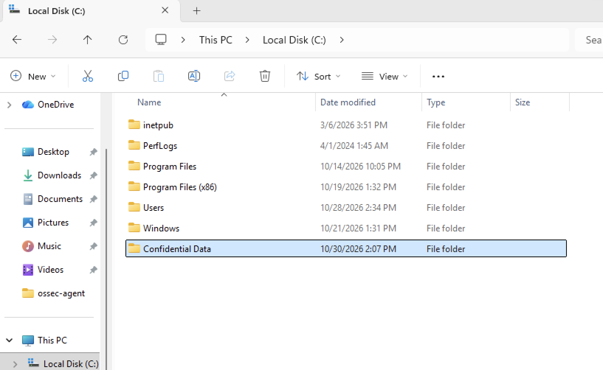
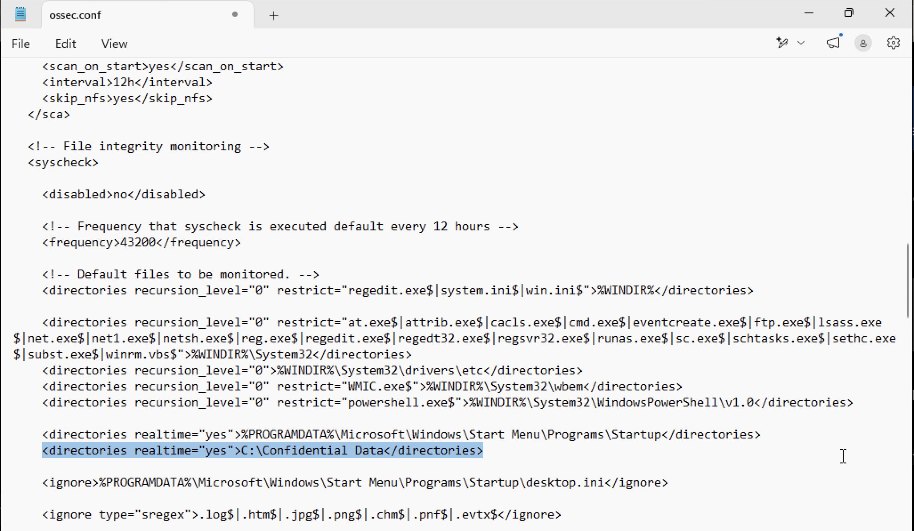
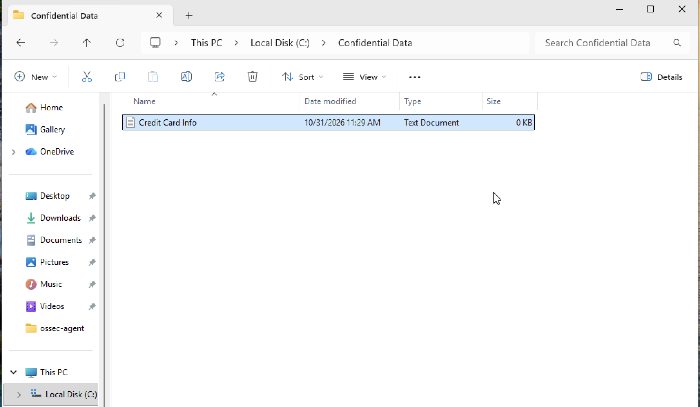
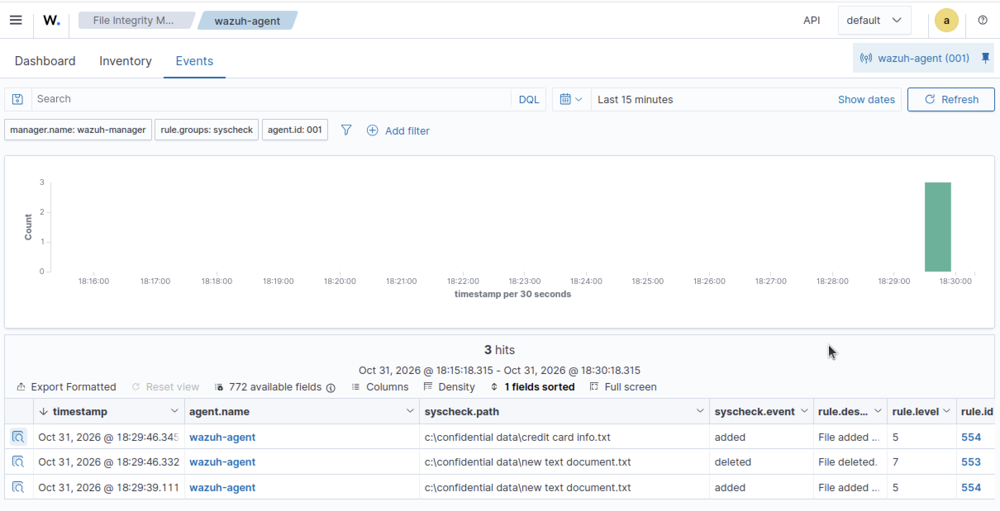

# File Integrity Monitoring

## Objective

To verify whether modifications to files within a monitored directory are detected and logged by Wazuh for security monitoring and investigation.

## Configuration

Prior to performing the detection scenario, a test directory named **Confidential Data** was created on the Windows 11 endpoint under **Local Disk (C:)**.



Following the directory creation, the Wazuh agent configuration file, **ossec.conf**, was modified to enable File Integrity Monitoring for the newly created directory.

Notepad was opened with administrative privileges, and the configuration file was located by navigating to **This PC → Local Disk (C:) → Program Files (x86) → ossec-agent → ossec.conf**. 

The following configuration entry was then added:

The following configuration entry was added under the "syscheck" section of **File integrity monitoring** to monitor the newly created directory in real time:

```
<directories realtime="yes">"C:\Confidential Data"</directories>
```



After saving the configuration file, the Wazuh agent service was restarted to apply the changes. Inside an administrator PowerShell session the command below was executed.

```
Restart-Service -Name wazuh
```

## Test Procedure

A text document named **Credit Card Info.txt** was created in the **Confidential Data** directory.



## Event Investigation

Under **Endpoint Security → File Integrity Monitoring**, the Wazuh Dashboard was reviewed for alerts associated with file activity in the **Confidential Data** directory.



## Detection Results

Wazuh successfully generated an alert indicating a new file was created within the monitored directory. 

## MITRE ATT&CK Mapping

- **Data Component:** DC0039 - File Creation