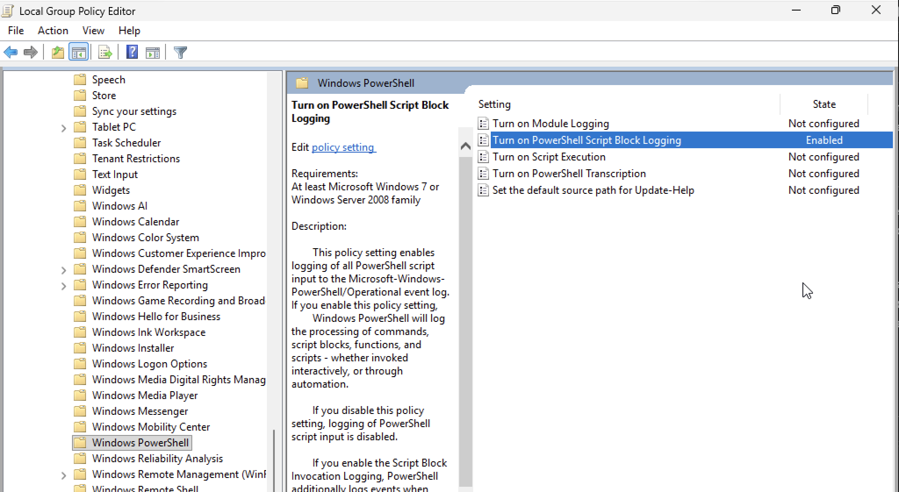
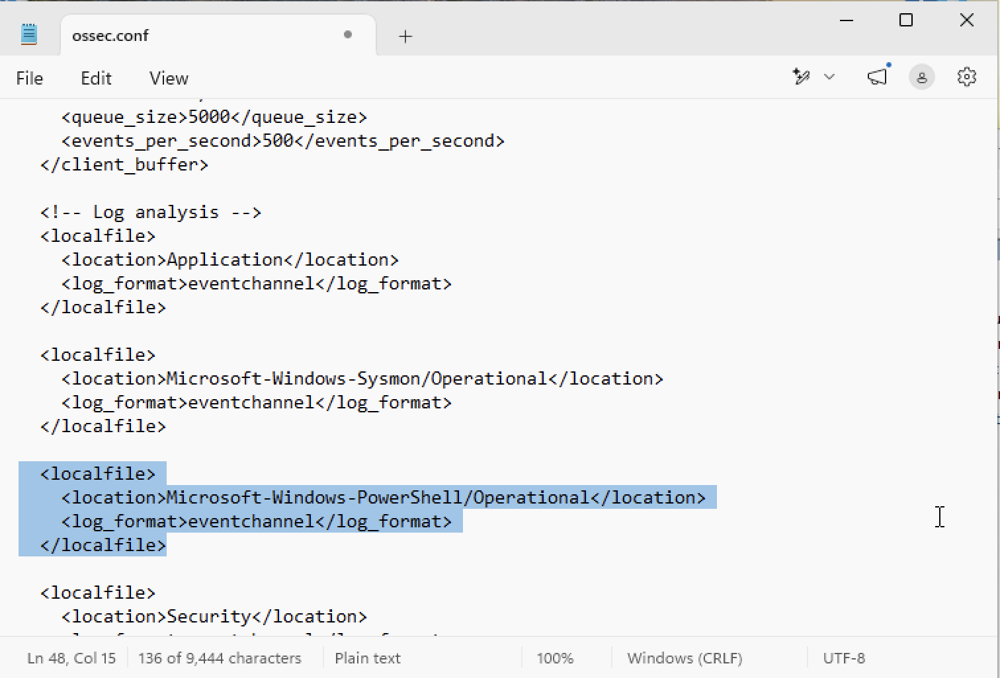
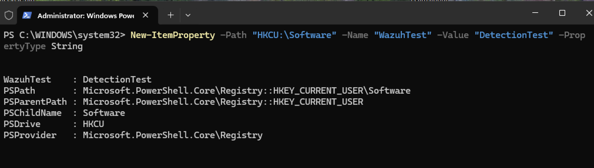
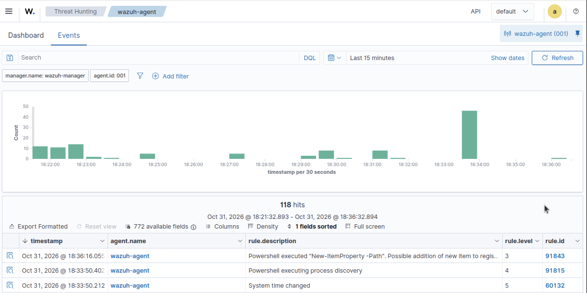

# Suspicious PowerShell Execution

## Objective

To evaluate whether Wazuh can detect and generate alerts for potentially suspicious PowerShell command execution on the Windows 11 endpoint.

---

## Configuration

Before testing whether PowerShell executions were being recorded by Wazuh, Windows PowerShell logging had to be enabled to ensure the activity was captured.

By opening **Local Group Policy Editor** and navigating to **Computer Configuration → Administrative Templates → Windows Components → Windows PowerShell**, the policy, **PowerShell Script Block Logging**, was enabled.



After this setup, the Wazuh Agent was configured to collect PowerShell activity. To do this, Notepad was opened with administrative privileges, and the following file was located by navigating to **This PC → Local Disk (C:) → Program Files (x86) → ossec-agent → ossec.conf**.

Under the **Log analysis** section, the following configuration was added:

```
<localfile>
    <location>Microsoft-Windows-PowerShell/Operational</location>
    <log_format>eventchannel</log_format>
</localfile>
```



The agent was then restarted in an administrative Windows PowerShell session for the changes to be applied.

```
Restart-Service -Name wazuh
```

---

## Test Procedure

A PowerShell session was opened with administrator privileges, and a new registry value was created using the following command:

```
New-ItemProperty -Path "HKCU:\Software" -Name "WazuhTest" -Value "DetectionTest" -PropertyType String
```


---

## Event Investigation

Within the **Threat Hunting** section of the Wazuh Dashboard, the collected events were reviewed to determine whether the registry modification activity generated an alert



After verifying the generated alert, the test registry value was removed from the Windows endpoint using the following command: 

```
Remove-ItemProperty -Path "HKCU:\Software" -Name "WazuhTest"
```

---

## Detection Results

Wazuh successfully generated an alert with **Rule ID 91843**, identifying the PowerShell activity associated with the registry modification. This confirmed that the activity was detected and recorded.

---

## MITRE ATT&CK Mapping

| Tactic | Technique | Technique ID |
|---|---|---|
| Defense Evasion | Modify Registry | T1112 |
| Execution | Command and Scripting Interpreter: PowerShell | T1059.001 |