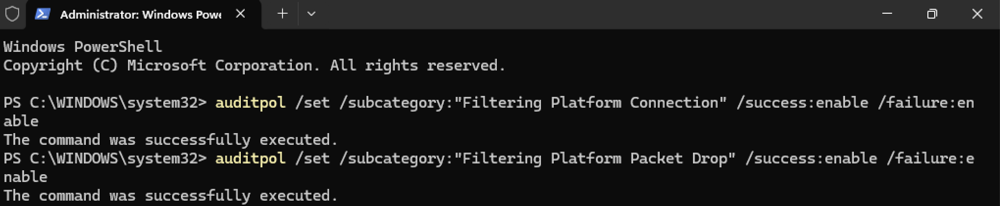
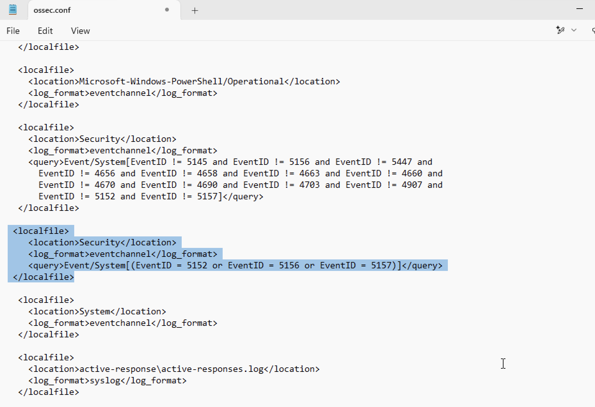
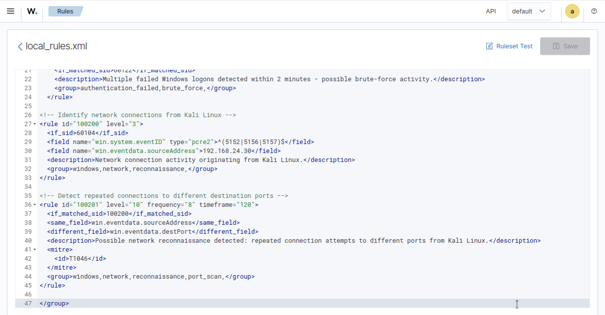
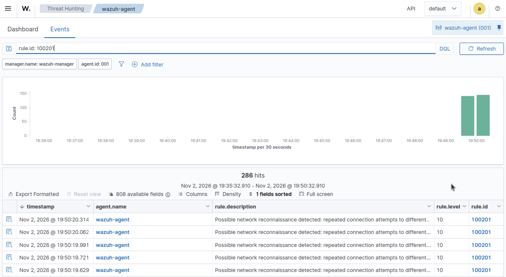

# Network Reconnaissance

## Objective

To evaluate whether Wazuh can detect network scanning activity and generate relevant security alerts.

## Configuration

Before performing the network reconnaissance tests, the Windows 11 endpoint was configured to audit Windows Filtering Platform connection and packet-drop events. This allowed successful and blocked connection attempts, as well as dropped network packets, to be recorded in the Windows Security event log.

The following commands were executed in a PowerShell session with administrative privileges:

```
auditpol /set /subcategory:"Filtering Platform Connection" /success:enable /failure:enable

auditpol /set /subcategory:"Filtering Platform Packet Drop" /success:enable /failure:enable
```


The **ossec.conf** file was then modified to ensure that Windows Event IDs 5152, 5156, and 5157 were not excluded from log collection. After opening the file in Notepad, the following configuration was added under the **Log analysis** section:

```
<localfile>
  <location>Security</location>
  <log_format>eventchannel</log_format>
  <query>Event/System[(EventID = 5152 or EventID = 5156 or EventID = 5157)]</query>
</localfile>
```



Following the configuration changes, the agent was restarted to ensure the changes were applied.

```
Restart-Service -Name Wazuh
```

Switching to the Ubuntu Server, a custom rule was then configured through the Wazuh Dashboard to generate an alert when the previously selected Event IDs were detected in connection with network activity originating from the Linux machine within a 2-minute window.

By navigating to **Server management → Rules → Custom rules**, **local_rules.xml** was modified to include the following:

```
  <!-- Identify network connections from Kali Linux -->
<rule id="100200" level="3">
  <if_sid>60104</if_sid>
  <field name="win.system.eventID" type="pcre2">^(5152|5156|5157)$</field>
  <field name="win.eventdata.sourceAddress">192.168.24.30</field>
  <description>Network connection activity originating from Kali Linux.</description>
  <group>windows,network,reconnaissance,</group>
</rule>

<!-- Detect repeated connections to different destination ports -->
<rule id="100201" level="10" frequency="8" timeframe="120">
  <if_matched_sid>100200</if_matched_sid>
  <same_field>win.eventdata.sourceAddress</same_field>
  <different_field>win.eventdata.destPort</different_field>
  <description>Possible network reconnaissance detected: repeated connection attempts to different ports from Kali Linux.</description>
  <mitre>
    <id>T1046</id>
  </mitre>
  <group>windows,network,reconnaissance,port_scan,</group>
</rule>
```



## Test Procedure

The Kali Linux machine was used to execute an Nmap command in **Terminal** to simulate an attacker performing network reconnaissance against the Windows endpoint. The following command was executed:

```
sudo nmap -A 192.168.24.20
```

## Event Investigation

Using the Wazuh Dashboard, alerts were filtered by rule ID 100201 to identify events generated by the network reconnaissance activity. The resulting alert indicated that network scanning activity originating from the Kali Linux machine had been detected.



## Detection Results

Wazuh successfully collected the network activity logs and generated an alert using custom rule ID 100201 following execution of the Nmap scan. Thus, confirming the detection rule identified network reconnaissance activity originating from the Kali Linux machine.

## MITRE ATT&CK Mapping

- **Tactic:** Discovery
- **Technique:** Network Service Discovery
- **Technique ID:** T1046