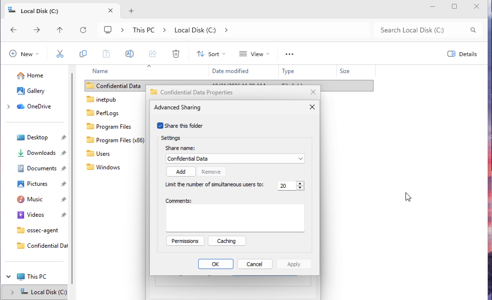
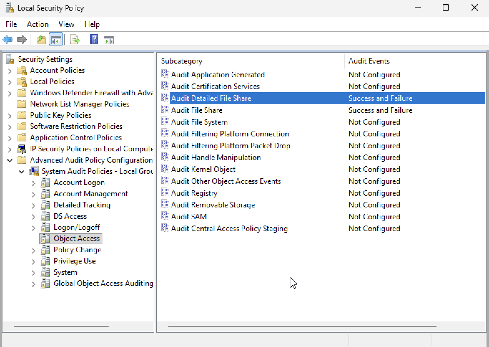
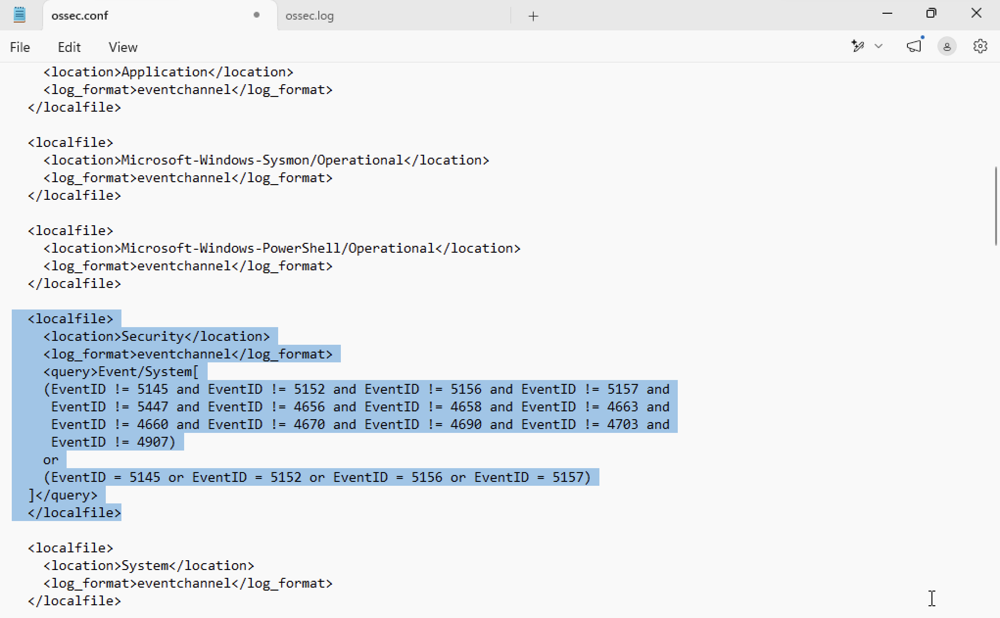
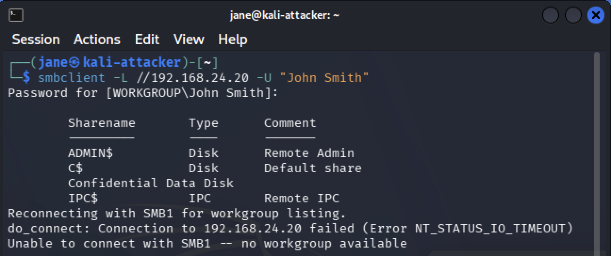
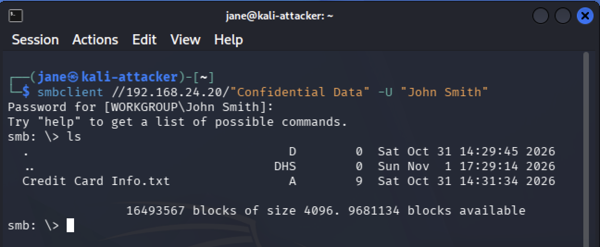
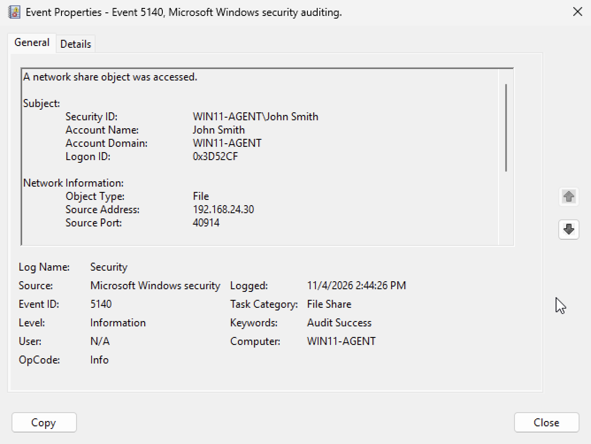
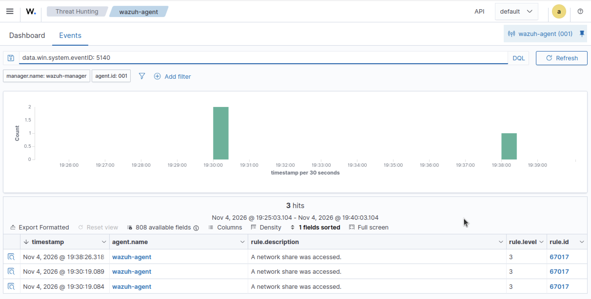

# SMB Enumeration

## Objective

To simulate SMB enumeration activity originating from the Kali Linux machine against the Windows 11 endpoint and verify whether the appropriate security events are collected and generated by Wazuh.

## Configuration

Prior to performing SMB enumeration, a network share was configured on the Windows 11 endpoint. The folder created during the previous detection was reused to establish the network share.

By navigating to **Local Disk (C:)**, right-clicking **Confidential Data** and selecting **Properties → Sharing → Advanced Sharing** The **Share this folder** option was enabled to make the folder accessible over the network. 



Following this configuration, auditing was enabled for the SMB protocol. The commands below were executed in an administrative Powershell session.

Following the network share configuration, SMB-related auditing was enabled on the Windows 11 endpoint to capture relevant access and enumeration activity. 

By opening **Local Security Policy** and navigating to **Advanced Audit Policy Configuration → System Audit Policies → Object Access**, the following audit policies were configured:

- **Audit Detailed File Share:** Success and Failure
- **Audit File Share:** Success and Failure



The **ossec.conf** configuration file was then modified to instruct the Wazuh Agent to collect SMB-related security events from the Windows Event Log. After opening the file in Notepad, the existing Security event collection configurations were consolidated into a single \<localfile> block, and the following configuration was added under **Log analysis**:

```
<localfile>
  <location>Security</location>
  <log_format>eventchannel</log_format>
  <query>Event/System[
    (EventID != 5145 and EventID != 5152 and EventID != 5156 and EventID != 5157 and
     EventID != 5447 and EventID != 4656 and EventID != 4658 and EventID != 4663 and
     EventID != 4660 and EventID != 4670 and EventID != 4690 and EventID != 4703 and
     EventID != 4907)
    or
    (EventID = 5145 or EventID = 5152 or EventID = 5156 or EventID = 5157)
  ]</query>
</localfile>
```



To apply the configuration changes, the Wazuh Agent service was restarted by executing the command below in an administrative PowerShell session.

```
Restart-Service -Name Wazuh
```

## Test Procedure

The Kali Linux machine was used to perform SMB enumeration by identifying available network shares and attempting to establish a connection to the previously configured network share. 

In a **Terminal** session, the following command was executed to enumerate the available SMB shares:

```
smbclient -L //192.168.24.20 -U "John Smith"
```



After identifying the available shares, a connection was established to the **Confidential Data** share by executing the following command:

```
smbclient //192.168.24.20/"Confidential Data" -U "John Smith"
```



## Event Investigation

Windows Event Viewer was used to examine the Security logs generated during the SMB enumeration activity and identify the associated Windows Event IDs. **Event ID 5140** was identified, indicating that a network share had been accessed.



After identifying the event, a search filter was applied in the Wazuh Dashboard to verify whether the activity was successfully detected. The following query was used to locate the corresponding event:

```
data.win.system.eventID: 5140
```



## Detection Results

The SMB enumeration test successfully generated Windows Security events that were collected and detected by Wazuh. The corresponding event was investigated in the Wazuh Dashboard, confirming that the SMB-related activity was successfully recorded.

## MITRE ATT&CK Mapping

| Tactic           | Technique                | Technique ID |
|------------------|--------------------------|--------------|
| Discovery        | Network Share Discovery  | T1135        |
| Lateral Movement | SMB/Windows Admin Shares | T1021.002    |