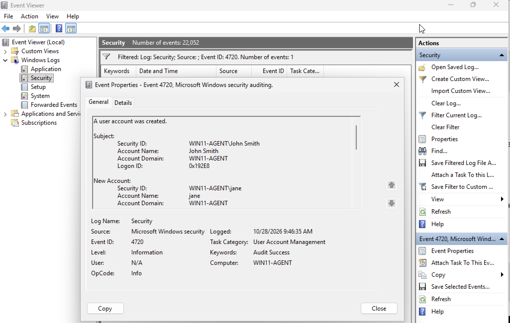
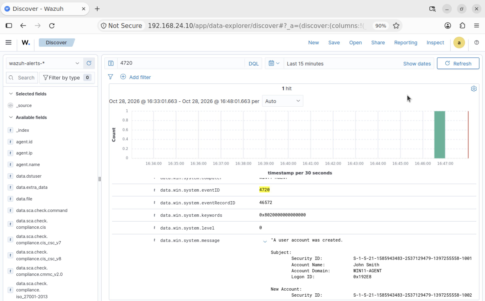

# Detection Testing

## Overview

This document outlines the security testing performed in the SIEM detection lab. Each test simulates a security-related activity to evaluate whether the resulting events are collected, analyzed, and, potentially flagged by Wazuh. The tests are conducted using the Windows 11 endpoint, with certain activities originating from the Kali Linux machine. The Wazuh Dashboard is used to verify event collection and investigate detection results.

## 1. User Account Creation

### Objective

To verify that the creation of a local user account on the monitored Windows 11 endpoint is recorded and can be investigated through Wazuh.

### Test Procedure

Using the default Windows user account with administrative privileges, a new local user account was created by executing the following command in **Command Prompt**.

```
net user jane password /add
```

### Event Investigation

The Windows Security log was examined in Event Viewer to verify that the account creation was recorded. The activity was logged as **Event ID 4720**, which indicates that a user account was created in Windows.



Using this Event ID, the Wazuh Dashboard was then examined to determine whether the event was collected.



### Detection Results

Wazuh successfully collected the account creation event and generated a corresponding alert. This confirmed that the activity was visible in the SIEM and identified by the configured detection rules.

### MITRE ATT&CK Mapping

- **Tactic:** Persistence
- **Technique:** Create Account: Local Account
- **Technique ID:** T1136.001

The simulated activity aligns with this technique because a new local Windows user account was created. Attackers may use this approach to maintain access to a compromised system.

## 2. Failed Logins