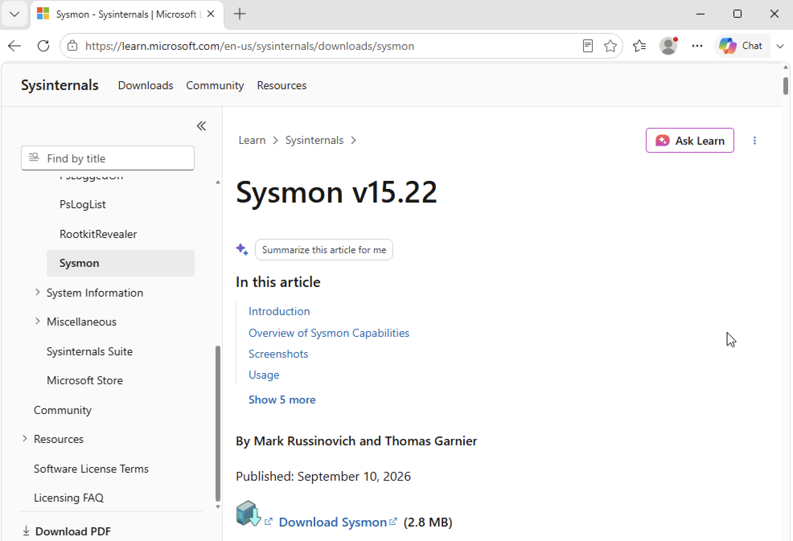
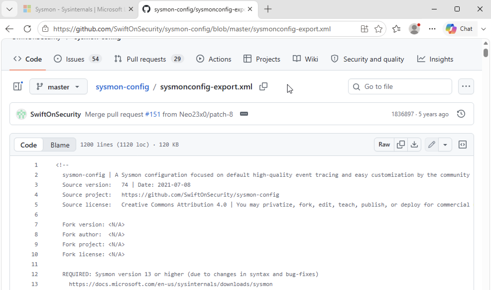
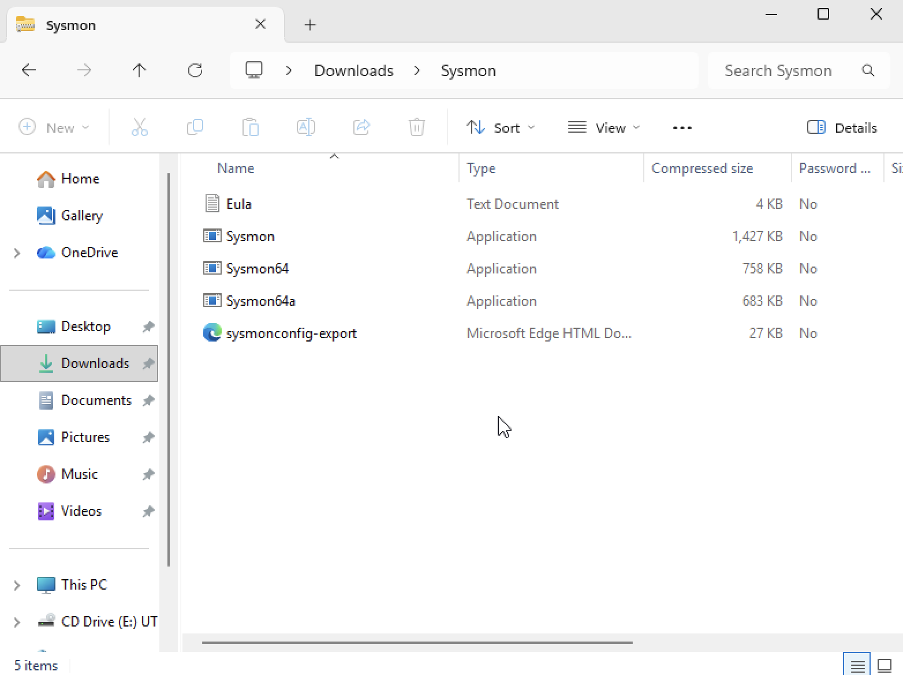
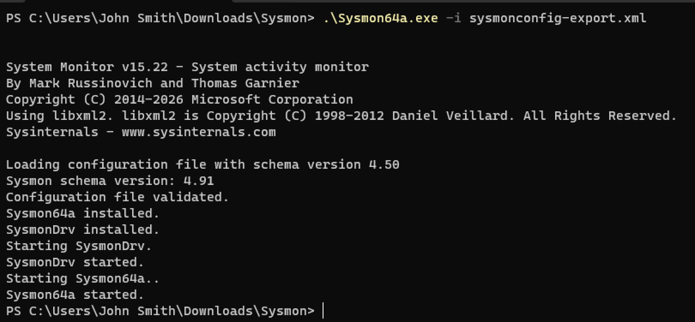
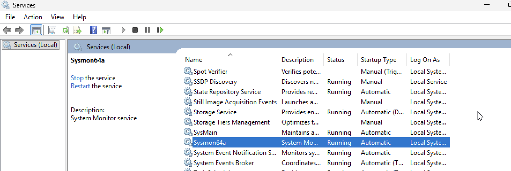
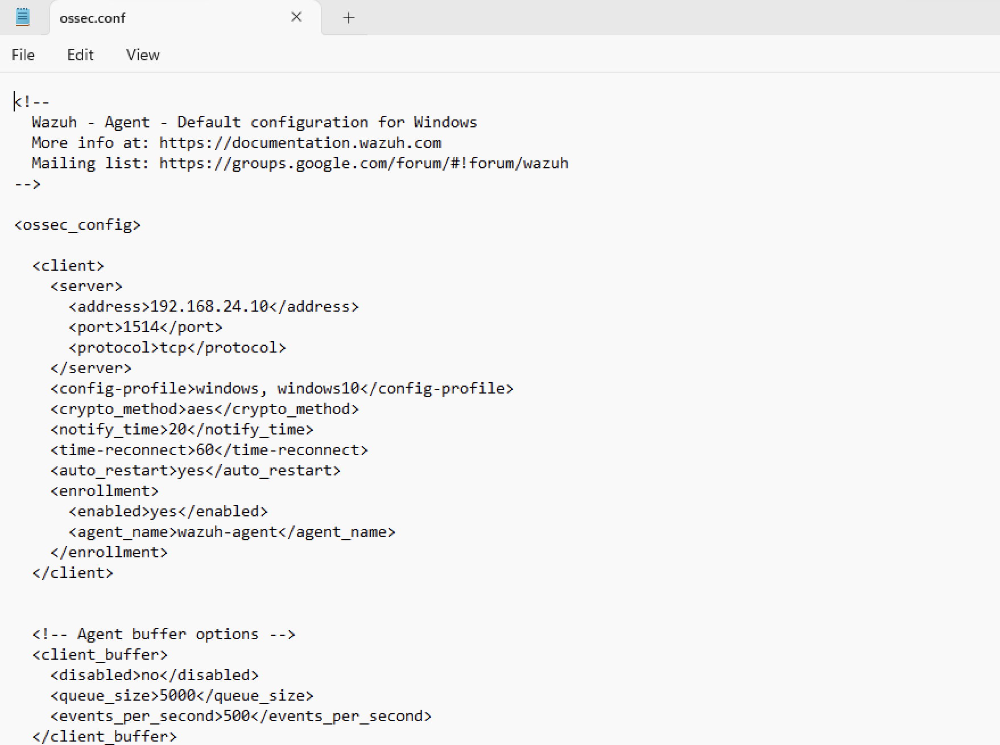
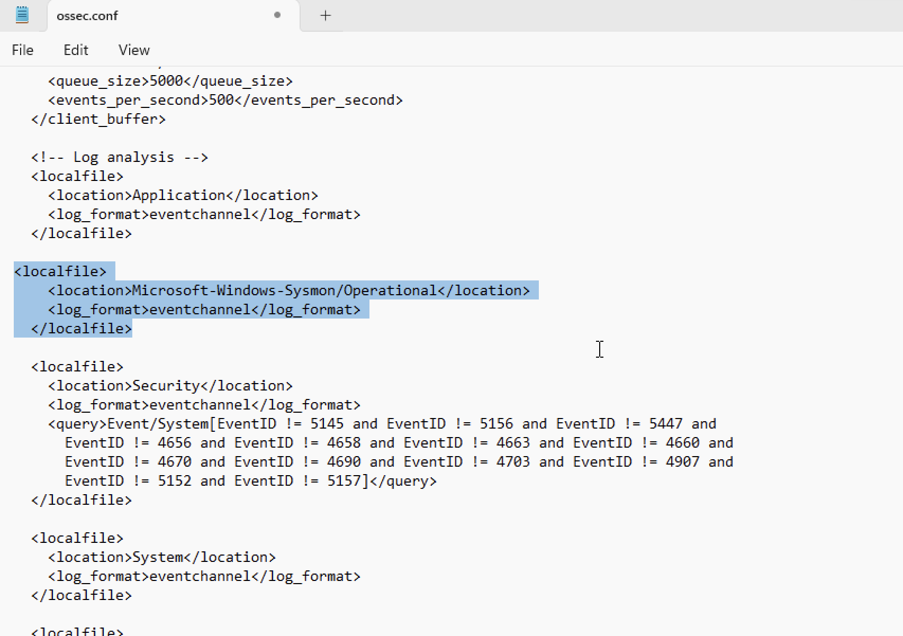
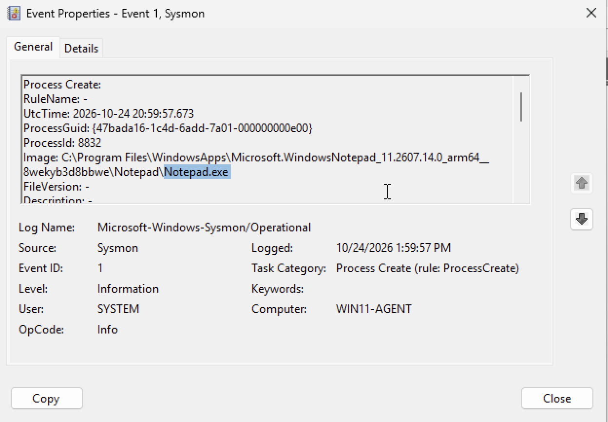
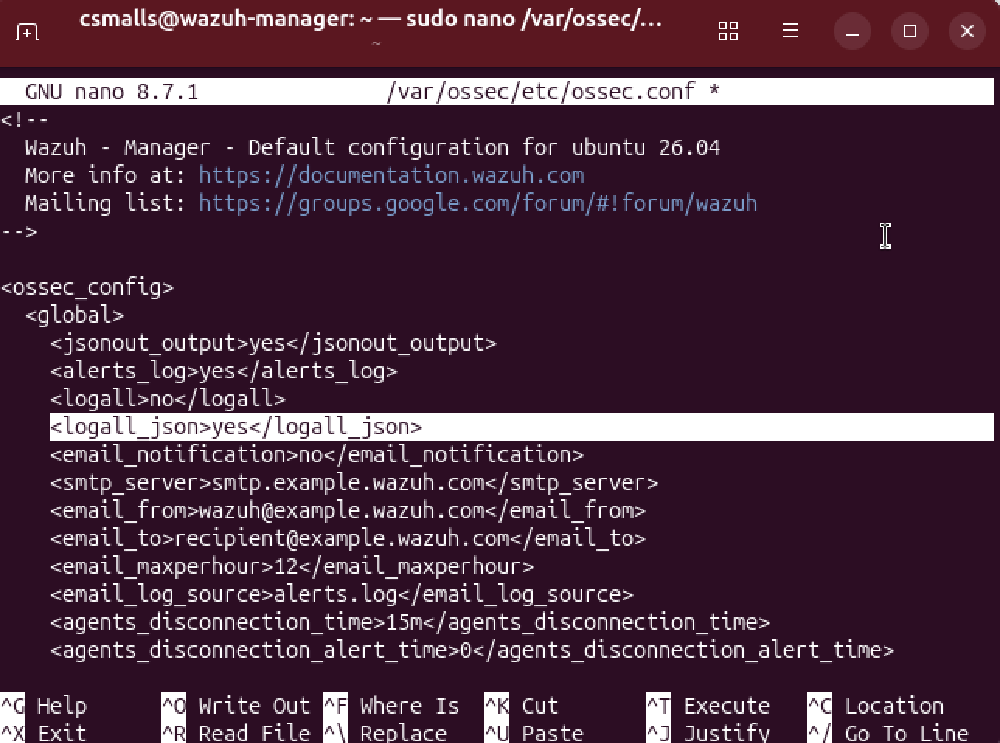

# Sysmon Installation and Configuration

This document describes the process of installing and configuring Sysmon to collect detailed system activity logs for security monitoring and investigation. 

## 1. Sysmon Download

The official Sysmon package was downloaded from the
[Microsoft Sysinternals website](https://learn.microsoft.com/en-us/sysinternals/downloads/sysmon).




## 2. Sysmon Configuration File Download
After downloading and extracting the Sysmon package, a configuration file was obtained to define which events Sysmon should monitor and log. The configuration template was downloaded from [SwiftOnSecurity's GitHub repository](https://github.com/SwiftOnSecurity/sysmon-config/blob/master/sysmonconfig-export.xml).



## 3. Sysmon Installation via Windows Powershell

Following this, the configuration file was moved to the extracted Sysmon directory in preparation for applying the configuration through **Windows PowerShell**.



Windows PowerShell was opened as an administrator, and the directory containing the Sysmon executable was accessed. The following command was executed to install Sysmon and apply the downloaded configuration file. The license agreement was also accepted during the installation process.

```
.\Sysmon64а.exe -i sysmonconfig-export.xml
```

***Note:** `Sysmon64a.exe` was selected because the Windows 11 virtual machine runs on an ARM64 architecture, consistent with the Apple Silicon host (MacBook Pro M1). Using the version that matches the guest operating system's architecture helps ensure compatibility.*

## 4. Verify Installation

The Windows **Services** console was then opened, and the `Sysmon64a` service was located to verify that it was running, indicating that Sysmon had been installed successfully.



## 5. Configure Wazuh to Collect Sysmon Events

Although Sysmon was installed, the Wazuh agent also needed to be configured to collect Sysmon events. This was accomplished by modifying the **ossec.conf** configuration file. Notepad was opened with administrator privileges, and the file was located by navigating to **This PC → Local Disk (C:) → Program Files (x86) → ossec-agent → ossec.conf**.


*By default, the Open dialog filters the displayed files by text documents. The **All Files** option was selected to display the ossec.conf configuration file.*

Under the "log analysis" section of **ossec.conf**, the following was added to enable the Wazuh agent to collect Sysmon events:

```
<localfile>
    <location>Microsoft-Windows-Sysmon/Operational</location>
    <log_format>eventchannel</log_format>
</localfile>
```


After saving the configuration file, the Wazuh agent service was restarted in an administrator PowerShell session to apply the changes.

```
Restart-Service -Name wazuh
```

## 6. Verify Log Collection

To verify the Sysmon configuration, a test was performed to confirm that events were being collected and forwarded to the Wazuh Manager. **Notepad** was opened on the Windows 11 endpoint, and the Wazuh Dashboard was searched for related events. However, no events referencing Notepad were found. As a result, troubleshooting was performed on the Windows agent to determine whether events were being recorded locally but not forwarded to the Wazuh Manager. 

By opening **Windows Event Viewer** and navigating to **Application and Services Logs → Microsoft → Windows → Sysmon → Operational**, it was confirmed that events were being recorded locally.



To determine whether the absence of Notepad-related events was due to the application activity not being captured by default, the **ossec.conf** file was temporarily modified on the Ubuntu VM. After opening **Terminal**, the following was executed to open the manager configuration:

```
sudo nano /var/ossec/etc/ossec.conf
```

Within the **ossec.conf** file, the <logall_json> setting was changed from "no" to "yes" to enable JSON archival of events:

```
<logall_json>yes</logall_json>
```


The manager was then restarted for the changes to go into effect.

```
sudo systemctl restart wazuh-manager
```

